# Multiplayer buffered Opus MVP

## Decision

Replace the choice between live WebRTC audio and whole-source-file transfer for audio and modules with a third delivery path: the host renders each track to time-indexed WebM/Opus in memory, then sends it over WebRTC data channels as fast as congestion control allows. The listener starts after a small contiguous window is present and keeps buffering toward the end of the track.

This is download-ahead streaming, not paced internet radio and not “download the whole file, then play.”

Video remains on the existing live RTP audio path for this MVP. There is no persistent encoded cache.

```mermaid
flowchart LR
  A["Host source file"] --> B["Offline decode or module render"]
  B --> C["48 kHz stereo Opus encoder"]
  C --> D["WebM init plus time-indexed clusters"]
  D --> E["Bounded in-memory render cache"]
  E --> F["Per-peer priority scheduler"]
  F --> G["Reliable unordered WebRTC data channel"]
  G --> H["Client sparse cluster store"]
  H --> I["MediaSource audio element"]
  I --> J["Listener-owned ReplayGain, Raf, analysis, and volume"]
```

## Why this shape

- Live RTP Opus is tied to wall-clock playout. A short jitter buffer cannot turn spare bandwidth now into protection against a long outage later.
- Whole-file transfer can use spare bandwidth, but the current client cannot play until every source byte arrives.
- Time-indexed encoded clusters provide both properties: immediate progressive playback and whole-track download ahead.
- The current ordered media channel cannot truly reprioritize a seek past bytes already submitted to SCTP. A reliable unordered channel plus a deliberately small `bufferedAmount` window bounds stale in-flight work and allows the next application-selected cluster to jump the queue.
- WebM/Opus is the primary Chromium target and gives MediaSource an initialization segment followed by timestamped, independently appendable audio clusters. Prove sparse, out-of-order cluster append in Chromium before building the complete path; if that spike fails, keep the same wire/cache design and replace only client playback with WebCodecs Opus decode and scheduled `AudioBufferSourceNode`s.

## Render and cache

Add a worker-backed render coordinator owned by Multiplayer services.

- Output: 48 kHz, stereo, Opus VBR at the existing configured bitrate, in WebM clusters of about one second.
- Regular audio: reuse Mediabunny's worker-side decode/transcode path and discard video tracks.
- Tracker modules: move/refactor the existing offline libopenmpt/Hively chunk renderer so PCM chunks feed the Opus encoder directly; do not materialize a whole-track `AudioBuffer`.
- Produce one continuous Opus timeline. Capture a WebM initialization segment and cluster-aligned byte ranges with start/end timestamps.
- The first implementation may finish the host render before announcing it. The client must still play before the transfer finishes. A later optimization may publish completed clusters while the remainder is still rendering.
- Cache key: source path, size, last-modified time, subsong, renderer settings/version, bitrate, channel layout, and sample rate.
- Deduplicate concurrent requests, including Freeplay peers requesting the same render.
- Store one shared set of `ArrayBuffer` clusters. Per-peer queues hold cluster indexes, not copied payloads.
- Pin active renders and evict unpinned entries by compressed-byte LRU under a configurable memory cap. Cancel obsolete unfinished work when it has no consumers.
- Never write renders to playlist/library records, IndexedDB, the service-worker cache, or disk.

The encoded audio is dry renderer output. On the client it enters the shared audio graph before listener-owned ReplayGain/Raf/analysis/master volume. Start, pause, seek, and replacement use short transition ramps. Exact two-track crossfade reproduction needs a host-authored transition schedule and is a follow-up; until then, an active overlap may retain the live RTP path rather than silently changing the mix.

## Wire protocol and scheduling

Bump the experimental protocol version without compatibility adapters.

Control messages:

- `render.manifest`: generation, render ID, track ID, codec/container, duration, bitrate, cluster duration, cluster timestamps/sizes, init size, and total bytes.
- `render.need`: generation, request epoch, target time, desired seconds ahead, and compact received-cluster ranges.
- `render.ready`: the client has enough contiguous media at the intended start position.
- `render.error`: bounded failure code; the host may fall back to live RTP for that generation.

Binary media frames identify render ID, request epoch, cluster index, fragment offset, and fragment length. Keep fragments small enough for broad RTC data-channel behavior (start with 16 KiB). Duplicate fragments are harmless; malformed or mismatched generations are dropped.

For each peer, choose unsent work in this order:

1. The newest seek target and its startup window.
2. The current authoritative playhead and its protection window.
3. Missing clusters from that point toward the end of the track.
4. Any earlier holes, then speculative work.

Do not application-pace to the Opus bitrate. Drain at available channel speed while honoring a small high-water mark for `bufferedAmount`; this is backpressure, not throttling. Pause does not stop download-ahead. A new track cancels that peer's old schedule but may leave the completed render in the LRU cache.

On seek, the client increments its request epoch, discards obsolete queued priorities, requests the cluster containing the new time plus the forward startup window, and resumes once that range is contiguous. Old in-flight clusters may still be retained for later, but cannot block the new request behind an unbounded ordered queue.

## Client playback

Create one Multiplayer-owned `MediaSource`/`SourceBuffer` pipeline and route its hidden audio element through the same listener-side Web Audio entry used by remote audio.

- Append the init segment once, then append available clusters in timestamp order within each requested window. Sparse buffered ranges are allowed.
- Start or resume only when the configured contiguous buffer exists at the desired time, or when the remainder of the track is shorter than that target.
- Continue accepting and storing clusters while playing until the render is complete.
- If playback catches the buffered edge, enter `buffering`, request the current host position at urgent priority, and resume at the host-authoritative position rather than accumulating permanent lag.
- A host seek changes priority, not the render ID. Track/bitrate/renderer changes create a new generation and MediaSource.
- On reconnect, send received ranges and request only missing clusters.
- Release all compressed clusters, object URLs, media elements, and SourceBuffers when a generation is no longer current and not cacheable client-side.

Normal hosted playback shares one render across listeners. Freeplay keeps a separate authoritative timeline and scheduler per peer, but reuses render cache entries across peers. Source bytes and buffered playback must never enter the host playlist or shared player controller for Freeplay.

## Options

Keep the Goldilocks controls under Options -> Experimental -> Multiplayer Audio:

- **Opus VBR bitrate**: retain it, but it now controls the actual pre-render rather than an RTP ceiling.
- **Start/rebuffer after**: replace the RTP jitter-buffer wording and expand the useful range; initial proposal is 3 seconds default, 1–30 seconds.
- **Pre-render memory limit**: compressed render-cache cap; initial proposal is 256 MiB with a small set of bounded choices.

Remove **Send files under** once buffered Opus covers audio and modules. Keep cluster duration and transport high-water marks internal until evidence shows that users benefit from exposing them.

## Implementation order

1. **Feasibility spike:** generate clustered WebM/Opus with Mediabunny, split init/clusters, and prove Chromium MediaSource can append the seek target without all preceding clusters. Test desktop and Android Chromium.
2. **Renderer:** add the worker, incremental regular/module inputs, cluster index, cancellation, shared promises, and bounded LRU cache.
3. **Transport:** replace source-file queueing with render manifests, binary fragment framing, reliable unordered delivery, range tracking, backpressure, and the priority scheduler.
4. **Playback:** add sparse client buffering, readiness/rebuffer states, seek epochs, reconnect range recovery, shared-audio-graph routing, and cleanup.
5. **Session integration:** make buffered Opus the audio/module default for hosted and Freeplay timelines; retain live RTP only for video, render failure, and temporarily unsupported transition overlap.
6. **Controls and diagnostics:** update synchronized-start gating, Options/i18n, and report render time, cache hit, transfer rate, buffered seconds, rebuffer count/duration, and requested cluster.
7. **Removal:** after parity tests, delete the whole-source-file audio mode and any RTP-only buffer controls that no longer have a video use.

## MVP acceptance

- An audio file and a tracker module begin playing after the startup window arrives, before the complete encoded track arrives.
- With average throughput above the selected bitrate but simulated 3–5 second outages, playback remains continuous after the initial buffer fills.
- Transfer commonly finishes well before playback and is never deliberately limited to real time.
- Seeking to an unreceived position makes that position the next scheduled window; it does not wait for earlier track bytes to finish.
- Pause continues buffering; resume is local when the target range is already present.
- Reconnect requests only missing clusters and stale generations cannot start playback.
- Main-session listeners share one render; Freeplay peers keep independent timelines without duplicate renders for the same cache key.
- The configured memory cap is honored under track churn, with active entries pinned and all worker/media resources released on teardown.
- Listener ReplayGain, Raf, analyser, master volume, mute, and autoplay-blocked states still behave as they do for current remote audio.
- Focused protocol, scheduler, range-map, cache, stale-generation, seek-priority, and cleanup tests pass, followed by `npm run check` and the required `npm run build` for implementation changes.

## Not in this MVP

- Video frame delivery or buffered video/audio synchronization.
- Persistent or service-worker caching of rendered media.
- Adaptive bitrate ladders or mid-track bitrate switching.
- Internet-facing HTTP/HLS hosting.
- Perfect crossfade overlap until transition scheduling is carried explicitly in the protocol.
